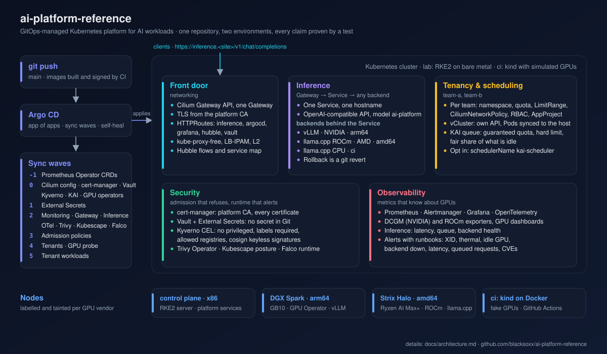
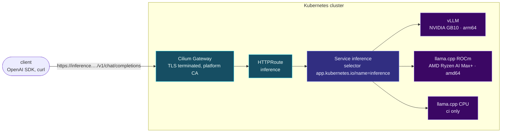
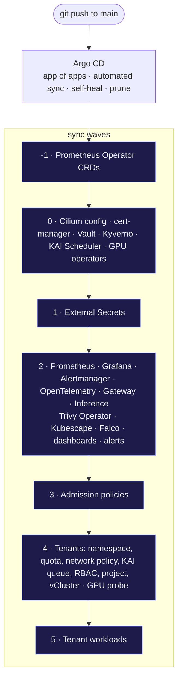
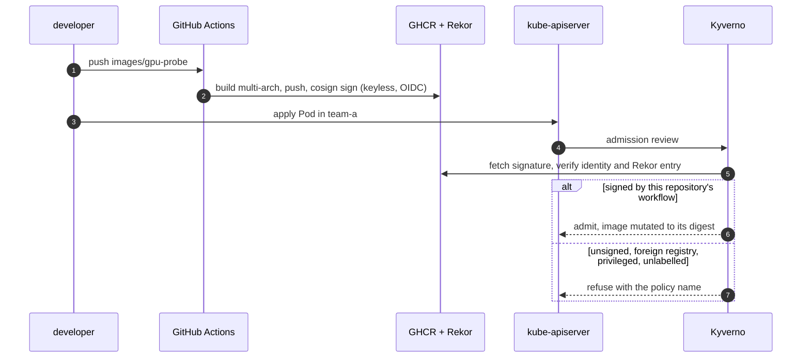

# ai-platform-reference

[](https://github.com/blacksoxx/ai-platform-reference/actions/workflows/ci.yml)
[](https://github.com/blacksoxx/ai-platform-reference/actions/workflows/e2e.yml)
[](https://github.com/blacksoxx/ai-platform-reference/actions/workflows/images.yml)
[](LICENSE)

A GitOps-managed Kubernetes platform for AI workloads. NVIDIA and AMD GPUs, arm64 and amd64,
in one cluster, applied entirely by Argo CD from this repository, with multi-tenancy, queue-based
GPU scheduling, an OpenAI-compatible inference front door, full observability and a standard
security stack. Every claim it makes is checked by an end-to-end test you can run on a laptop.



## What it does

- **Two GPU vendors, two CPU architectures, one cluster.** vLLM serves on an NVIDIA DGX Spark
  (GB10, arm64) and llama.cpp with ROCm on an AMD Ryzen AI Max+ box (amd64), behind one
  Service and one Gateway route. Clients call `ai-platform` and never learn which vendor answered.
- **Tenants share the GPUs through queues, not node labels.** Each team gets a namespace with
  quota, limits, a Cilium network policy, an RBAC binding, an Argo CD project, a KAI Scheduler
  queue with a guaranteed share and a hard cap, and its own virtual cluster (vCluster) as a
  self-service API.
- **Admission that refuses, not warns.** Kyverno's CEL-based policies refuse privileged
  containers, unlabelled Pods, foreign registries, and any platform image that was not signed
  by this repository's CI (Sigstore keyless, verified against Rekor).
- **Runtime and posture, with proof.** Falco detects a shell opened in a container and forwards
  it to Alertmanager; Trivy Operator and Kubescape write vulnerability and posture reports into
  the cluster. Each has a test that triggers it on purpose.
- **Observability that knows about GPUs.** DCGM and ROCm metrics in Prometheus, Grafana
  dashboards for GPUs and inference, alerts for the failures that happen (XID errors, thermal
  throttling, idle allocations, backends down, latency, queues), each with a runbook.
- **Secrets from Vault.** External Secrets Operator reads Vault through Kubernetes auth; no
  secret value lives in Git.
- **A simulated-GPU CI.** A kind cluster with the Run:ai fake GPU operator runs the whole
  platform, scheduling included, on a laptop or a GitHub runner.

## How a request gets answered

One hostname, one Gateway listener with the platform's own certificate, one Service, and
whichever backend has the capacity. Adding a vendor is adding a Deployment with the shared
label; removing one is a `git revert`.



## How the cluster is built

`git push` is the only deployment action. Argo CD applies one Application per component from
[apps/](apps), in sync waves, and waits for each wave to be Healthy before the next.



Every component is a Kustomize overlay that pulls its upstream Helm chart at a pinned version,
so `make lint` renders the whole platform exactly as Argo CD does and validates it offline.

## How an image gets into a tenant namespace

Supply chain and admission are one chain: CI signs, Kyverno verifies, the Pod runs by digest or
not at all.



## Quick start: the ci environment on your machine

Prerequisites: Docker (Docker Desktop or OrbStack), `kind`, `kubectl`, `helm`, `kustomize`,
the `cilium` CLI, and 12 GB of memory for Docker. Versions used in CI are pinned in
[.github/workflows/e2e.yml](.github/workflows/e2e.yml).

```sh
git clone https://github.com/blacksoxx/ai-platform-reference.git
cd ai-platform-reference
make ci-up        # kind cluster, Gateway API CRDs, Cilium, Argo CD, root Application (~5 min)
make ci-status    # watch the Applications turn Synced / Healthy, wave by wave
make e2e          # wait for every Application, then run every proof (~20 min on first run)
```

When it is up, the UIs are on the Gateway address `172.18.255.10` with nip.io hostnames:

| UI | URL | Login |
|---|---|---|
| Argo CD | https://argocd.172-18-255-10.nip.io | `admin`, password from `kubectl -n argocd get secret argocd-initial-admin-secret -o jsonpath='{.data.password}' \| base64 -d` |
| Grafana | https://grafana.172-18-255-10.nip.io | `admin`, password from Vault: `kubectl -n monitoring get secret grafana-admin -o jsonpath='{.data.admin-password}' \| base64 -d` |
| Hubble | https://hubble.172-18-255-10.nip.io | none |
| Vault | https://vault.172-18-255-10.nip.io | token `root` (dev mode, ci only) |
| Inference | https://inference.172-18-255-10.nip.io/v1/chat/completions | OpenAI API, model `ai-platform` |

The certificate is issued by the platform's own CA; import `platform-root-ca` from the
`cert-manager` namespace or use `curl -k`. [docs/setup-ci.md](docs/setup-ci.md) has the details,
including how to reach the Gateway address from your machine. `make ci-down` removes everything.

## What the end-to-end test proves

Every proof is a script in [scripts/e2e.d](scripts/e2e.d), run by `make e2e` after all
Applications are Healthy. The same suite runs on every push to `main` on a GitHub runner; the
`e2e` badge above is its last result.

| Proof | Claim |
|---|---|
| 10 gpu-job | A Job requesting `nvidia.com/gpu` is scheduled on a GPU node and completes |
| 20 gpu-metrics | DCGM metric series are scraped by Prometheus |
| 30 alert-pipeline | An alert fired on purpose reaches Alertmanager |
| 40 kyverno-privileged | Privileged, unlabelled and foreign-registry Pods are refused in a tenant namespace |
| 41 kyverno-unsigned | An unverifiable platform image is refused; the signed one is admitted by digest |
| 50 falco-shell | A terminal shell in a container is detected and forwarded to Alertmanager |
| 60 / 61 reports | Trivy and Kubescape reports exist |
| 70 tenant-rbac | A team member is confined to the team namespace and cannot touch its quota |
| 71 tenant-network | Cross-tenant traffic is dropped; DNS and the team's own services still work |
| 72 kai-queue | A third GPU job waits for the queue limit, then runs |
| 73 vcluster | A Pod created in a tenant's virtual cluster runs on the host, in the tenant namespace |
| 80 inference | A chat completion sent through the Gateway over TLS is answered |

## The lab: real hardware

The same repository drives an RKE2 cluster with the DGX Spark and the Ryzen AI Max+ box as
GPU nodes. Node configuration, the Cilium values and a per-role bootstrap live in
[clusters/lab](clusters/lab); the procedure, from the join token to the first completion on
each GPU, is [docs/setup-lab.md](docs/setup-lab.md).

**Validation status.** The ci environment is what the badges and the proofs cover: the whole
platform converges and all thirteen proofs pass on GitHub Actions (a 4-vCPU runner) and on a
16-core x86 host. The lab environment renders and lints with the same `make lint` and mirrors
ci component by component, but it has not yet run on the hardware: no proof has crossed a real
NVIDIA or AMD GPU. Until this paragraph changes, read `clusters/lab` and the lab overlays as
the design, checked by review and rendering, not by a run.

## Components

| Concern | Component | Version |
|---|---|---|
| GitOps | Argo CD | chart 10.17.0 (v3.6.1) |
| Networking, policy, Gateway, flows | Cilium with Hubble and Gateway API | 1.20.4, Gateway API v1.6.3 |
| Certificates | cert-manager | v1.21.3 |
| Secrets | HashiCorp Vault, External Secrets Operator | 0.34.1 (2.0.4), 2.14.0 |
| Admission | Kyverno | 3.9.2 (v1.19.2) |
| Image and config scanning | Trivy Operator | 0.38.1 |
| Runtime detection | Falco with Falcosidekick | 9.2.2 (0.45.2) |
| Posture | Kubescape operator | 1.42.0 |
| Metrics, alerts, dashboards | kube-prometheus-stack | 92.22.0 (operator v0.94.2) |
| Traces and OTLP | OpenTelemetry Collector | 0.178.2 (0.163.2) |
| NVIDIA GPUs | GPU Operator (driver and toolkit from DGX OS) | v26.7.2 |
| AMD GPUs | ROCm device plugin, device metrics exporter | 0.22.0, v1.5.3 |
| Simulated GPUs (ci) | Run:ai fake-gpu-operator | 0.2.1 |
| Scheduling | KAI Scheduler | v0.18.7 |
| Tenancy | vCluster | 0.37.6 |
| Inference | vLLM (NVIDIA), llama.cpp (AMD, CPU) | nvcr.io/nvidia/vllm 26.10, ghcr.io/ggml-org/llama.cpp |
| Kubernetes | kind 1.36.4 (ci), RKE2 v1.36.6+rke2r1 (lab) | |

Every version is pinned where it is used, with the date it was checked and, for images, the
digest. `make lint` renders every overlay the way Argo CD does and validates it against the
Kubernetes and CRD schemas; the chart version of a component must be the same in all its overlays.

## Repository layout

```
clusters/      ci: kind config, Cilium values, bootstrap, root Application · lab: RKE2 configs, bootstrap
platform/      one directory per component: base/ and overlays/{ci,lab}, upstream charts pinned
apps/          app of apps per environment, one Application per component, ordered by sync wave
tenants/       the tenant package and the team-a / team-b instances
workloads/     the gpu-probe Job and a notebook-style tenant Deployment
policies/      Kyverno policies with offline tests
dashboards/    Grafana dashboards as ConfigMaps · alerts/ PrometheusRules
images/        images built by CI, multi-arch, signed
scripts/       lint, e2e, proofs, hardware checks
docs/          architecture, setup guides, ADRs, runbooks, SLOs, demo
```

## Documentation

- [Architecture](docs/architecture.md): environments, sync waves, request path, tenancy,
  scheduling, security controls, observability, supply chain, with diagrams per section.
- [Set up the ci environment](docs/setup-ci.md) and [set up the lab](docs/setup-lab.md).
- [Architecture decision records](docs/adr): why Kustomize with Helm charts under Argo CD, why
  Vault, why KAI and vCluster, why kube-proxy-free Cilium with Gateway API, and the rest.
- [Runbooks](docs/runbooks): one per alert, plus Vault initialisation and inference rollback.
- [Service level objectives](docs/slos.md) and the [demo script](docs/demo.md).

## License

Apache-2.0. See [LICENSE](LICENSE).
