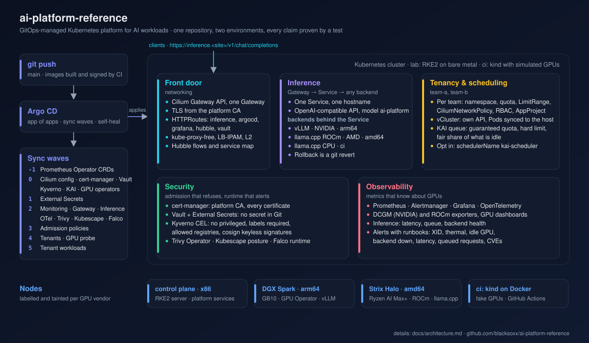
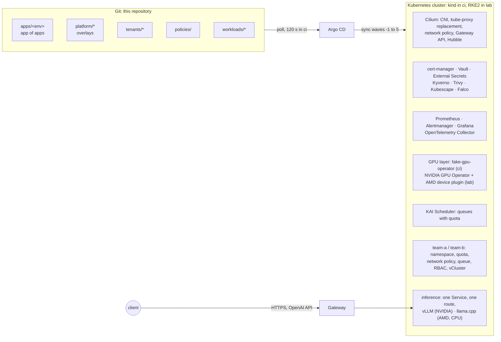
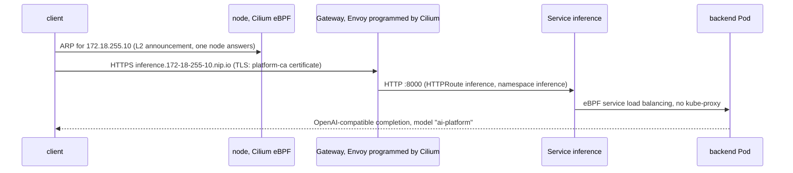
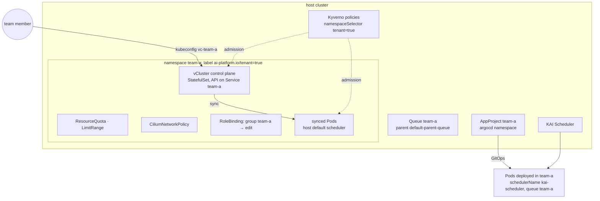

# Architecture

This document describes how the platform is put together: what runs where, how it is applied,
how a request reaches a model, how tenants are kept apart, and which control proves what.
Decisions and their alternatives are in the [ADRs](adr/); procedures are in
[setup-ci.md](setup-ci.md), [setup-lab.md](setup-lab.md) and the [runbooks](runbooks/).

## 1. Overview

Two things are installed by hand, once, per environment: the CNI (a controller cannot apply
the network it needs to run) and Argo CD itself, from the same overlay Argo CD then manages.
Everything else is an Argo CD Application created by the root Application from `apps/<env>/`.

## 2. Environments

| | ci | lab |
|---|---|---|
| Cluster | kind 1.36.4, one control plane, two workers, own Docker network 172.18.0.0/16 | RKE2 v1.36.6+rke2r1, control plane on an x86 box, agents on the DGX Spark (arm64) and the Ryzen AI Max+ (amd64) |
| CNI | Cilium 1.20.4 by the bootstrap (`clusters/ci/cilium-values.yaml`) | Cilium bundled with RKE2, tuned by a HelmChartConfig (`clusters/lab/rke2/manifests/`) |
| GPUs | Run:ai fake-gpu-operator: two simulated GPUs per worker | NVIDIA GPU Operator with driver and toolkit disabled (DGX OS provides both); ROCm device plugin and metrics exporter on the AMD node |
| Gateway address | 172.18.255.10 from the LB-IPAM pool, announced on the kind network | an address from the lab pool (`platform/cilium/overlays/lab/lb-ip-pool.yaml`, set per site) |
| Hostnames | `*.172-18-255-10.nip.io` | `*.lab.ai-platform.local` |
| Inference backend | llama.cpp on CPU, Qwen2.5-0.5B | vLLM with Qwen2.5-7B on the Spark, llama.cpp ROCm with Qwen2.5-7B on the Halo |
| Vault | dev mode, seeded by a Job | standalone with persistent storage, initialised by runbook |
| Runs | laptop (`make ci-up`), GitHub Actions (`e2e.yml`) | operator-driven (`clusters/lab/bootstrap.sh`) |

The two environments share every base. An overlay changes sizes, placement, hostnames and the
GPU layer, nothing else. `make lint` renders both.

## 3. GitOps model

### Bootstrap, then self-management

`clusters/ci/bootstrap.sh` creates the kind cluster, applies the Gateway API CRDs, installs
Cilium with Helm, applies `platform/argocd/overlays/ci` with Kustomize, and applies
`clusters/ci/root-app.yaml`. From that point Argo CD owns everything, including itself: the
`argocd` Application points at the very overlay the bootstrap applied, so there is no drift
between what was installed and what is managed.

### App of apps and sync waves

The root Application syncs `apps/ci/`, a Kustomization of Application manifests. Argo CD
applies them in waves and waits for each wave to be Healthy before starting the next (the
health of an Application resource is restored with the Lua check from the Argo CD docs, see
`platform/argocd/base/values.yaml`).

| Wave | Applications | Why here |
|---|---|---|
| -1 | prometheus-operator-crds | ServiceMonitor and PrometheusRule CRDs before anyone ships one |
| 0 | argocd, cilium (config), cert-manager, vault, kyverno, kai-scheduler, fake-gpu-operator / nvidia-gpu-operator, amd-device-plugin | operators and core services with no dependencies |
| 1 | external-secrets | its ClusterSecretStore needs the Vault role created in wave 0 |
| 2 | kube-prometheus-stack, gateway, inference, otel-collector, dashboards, alerts, trivy-operator, kubescape, falco, amd-metrics-exporter | need the CA, External Secrets or the monitoring CRDs |
| 3 | policies | the admission engine must be serving before policies are enforced |
| 4 | tenants (ApplicationSet), gpu-probe workloads | tenant namespaces, queues, vClusters |
| 5 | tenant workloads | need the tenants |

Two rules came out of building this and are worth keeping:

- **An HTTPRoute lives with the Gateway Application, not with the component it exposes.** A
  route is only Healthy once a Gateway has accepted it and its backend resolves; a route in a
  wave-0 Application can never become Healthy before the Gateway of wave 2, and the root
  Application never moves on. Inside the Gateway Application the certificate is wave 0, the
  Gateway wave 1, the routes wave 2.
- **Custom resources of a chart in the same Application skip the dry run** with
  `argocd.argoproj.io/sync-options: SkipDryRunOnMissingResource=true` and sit one wave later
  than the chart, so the CRD exists when they are validated.

### Rendering

Every component is a Kustomize overlay. Upstream software comes in through the `helmCharts`
field of `kustomization.yaml`, with the chart version pinned in each overlay and the shared
values in `base/values.yaml`; Argo CD renders with `kustomize build --enable-helm
--load-restrictor LoadRestrictionsNone`, the same flags `scripts/lint.sh` uses. Raw manifests
(policies, tenants, workloads, dashboards, alerts) are plain Kustomizations.

## 4. Networking and the request path

- Cilium runs with `kubeProxyReplacement: true` (a requirement of its Gateway API support):
  Services are implemented in eBPF, there is no kube-proxy DaemonSet, and the
  `kube_node_status_*` alerts for kube-proxy are disabled.
- The Gateway API controller creates a Service of type LoadBalancer per Gateway. LB-IPAM
  allocates its address from a `CiliumLoadBalancerIPPool`; a `CiliumL2AnnouncementPolicy` makes
  the nodes answer ARP for it on their interface. In ci the pool is the top /24 of the kind
  Docker network and the Gateway pins `172.18.255.10`, which is why nip.io hostnames work
  without DNS.
- One Gateway, class `cilium`, with an HTTP listener and an HTTPS listener whose certificate is a
  cert-manager `Certificate` from the `platform-ca` ClusterIssuer (self-signed root, ten years;
  leaf certificates ninety days). Routes attach from any namespace (`allowedRoutes: from: All`).
- Network policy is Cilium's: each tenant namespace carries a `CiliumNetworkPolicy` that admits
  ingress from the tenant itself, the Gateway namespace and Prometheus, and egress to the
  tenant, DNS (with DNS visibility in Hubble), the API server entity, the inference namespace
  and the world. Everything else is dropped; Hubble shows it.

## 5. GPU layer

Nodes with GPUs carry the label `ai-platform.io/gpu=<vendor>` and the taint
`ai-platform.io/gpu=<vendor>:NoSchedule`. Platform services never land on a GPU node; GPU
workloads tolerate the taint and select the vendor they need.

| | ci | lab, NVIDIA | lab, AMD |
|---|---|---|---|
| Resource | `nvidia.com/gpu`, simulated | `nvidia.com/gpu` | `amd.com/gpu` |
| Provider | fake-gpu-operator on nodes labelled `run.ai/simulated-gpu-node-pool=default` | GPU Operator: device plugin, GFD, DCGM exporter, validators; driver and toolkit components off because DGX OS ships them | ROCm k8s-device-plugin with the node labeller; the AMD GPU Operator targets Instinct, not APUs |
| Metrics | DCGM-style series from the fake exporter, scraped by a ServiceMonitor | DCGM exporter via the operator's ServiceMonitor | ROCm device metrics exporter |
| What a Pod sees | a fake `nvidia-smi` | the host driver's `nvidia-smi` and libraries (CDI) | `/dev/kfd` and the render node |

`images/gpu-probe` prints exactly that from inside a container; `workloads/gpu-probe` runs it
as a Job in every environment.

## 6. Scheduling

KAI Scheduler owns GPU placement. The chart creates `default-parent-queue`; every tenant gets
a leaf queue under it with a guaranteed share (`quota`), a hard cap (`limit`) and a weight for
the share of spare capacity (`overQuotaWeight`). A workload opts in with
`schedulerName: kai-scheduler` and the label `kai.scheduler/queue: <team>`; everything else is
scheduled by the default scheduler. With two tenants at `gpu: {quota: 1, limit: 2}` on four
GPUs, each team is guaranteed one, may take two, and a third job of the same team waits
(proof 72). Quota beats node labels once two teams share hardware: nobody has to be told which
node is theirs, and nothing idles because a label pinned it to the wrong box.

## 7. Tenancy

The tenant package (`tenants/base`) is one namespace, its guard rails, its queue, its RBAC and
its Argo CD project; `tenants/team-a` and `tenants/team-b` rename it and add a vCluster. The
vCluster control plane runs inside the tenant namespace, so it is subject to the same quota,
network policy and admission policies as the team's workloads (its image registry is allowed,
its Pod carries the required label, and the namespace enforces the baseline Pod Security
profile because the control plane runs as root). Pods created in the virtual cluster are synced
to the host namespace and placed by the host's default scheduler; handing them to KAI needs
vCluster's hybrid scheduling, an enterprise feature, so GPU work that must queue is deployed in
the tenant namespace through the team's Argo CD project, where `schedulerName: kai-scheduler`
and the queue label apply (ADR 0004). Proofs: 70 (RBAC), 71 (network), 72 (queue), 73 (vCluster).

## 8. Security controls

| Control | Component | Where | Proof |
|---|---|---|---|
| No privileged containers in tenant namespaces | Kyverno `ValidatingPolicy` | `policies/disallow-privileged-containers.yaml` | 40 |
| Required `app.kubernetes.io/name` label | Kyverno `ValidatingPolicy` | `policies/require-labels.yaml` | 40 |
| Images only from the platform registry, vLLM, llama.cpp and vCluster registries | Kyverno `ValidatingPolicy` | `policies/restrict-image-registries.yaml` | 40 |
| Platform images signed by this repository's CI | Kyverno `ImageValidatingPolicy`, cosign keyless, Rekor | `policies/verify-image-signatures.yaml` | 41 |
| Pod Security Standards | namespace labels: restricted for platform namespaces, baseline where a component needs it, privileged only for node agents | every `namespace.yaml` | |
| Network isolation between tenants | Cilium network policy | `tenants/base/network-policy.yaml` | 71 |
| Runtime detection | Falco, modern eBPF probe; Falcosidekick to Alertmanager | `platform/falco` | 50 |
| Vulnerability and configuration reports | Trivy Operator | `platform/trivy-operator` | 60 |
| Posture and compliance scans, node checks | Kubescape operator | `platform/kubescape` | 61 |
| TLS everywhere outside the cluster | cert-manager, platform CA | `platform/cert-manager`, `platform/gateway` | |
| Secrets outside Git | Vault + External Secrets | `platform/vault`, `platform/external-secrets` | Grafana's admin secret |
| RBAC per tenant | RoleBinding to `edit`, AppProject scoped to the namespace | `tenants/base/rbac.yaml`, `argocd-project.yaml` | 70 |

The policies are tested offline with `kyverno test policies` in `make lint`, against a
tenant namespace and a platform namespace, so a change to a policy fails before it is merged.

## 9. Secrets

Vault runs in-cluster. A Job (ci) or the operator (lab, [runbook](runbooks/vault-init.md))
enables the Kubernetes auth method, mounts a KV v2 engine at `platform/`, writes a read-only
policy and binds it to a role for the External Secrets service account (audience `vault`).
A `ClusterSecretStore` named `vault` points at it; components declare `ExternalSecret`
resources that materialise Kubernetes Secrets. The first consumer is Grafana's admin password:
seeded in Vault, never written in Git.

## 10. Observability

- **Discovery.** Prometheus selects every ServiceMonitor, PodMonitor, PrometheusRule and
  Probe in the cluster; components ship their own. The Prometheus Operator CRDs are installed
  one wave before anything else for that reason.
- **Dashboards** are ConfigMaps labelled `grafana_dashboard=1` with a `grafana_folder`
  annotation, loaded by Grafana's sidecar: NVIDIA's DCGM dashboard and the GPU queues
  dashboard (GPU folder: capacity versus requests, Pods running and waiting per KAI queue,
  requests per namespace, utilisation per node), and the inference dashboard (requests in
  flight and queued, tokens per second and queue depth per backend, vLLM latency quantiles and
  KV cache usage). kube-state-metrics exposes the KAI queue label on Pods for the queue views.
- **Alerts** are PrometheusRules in `alerts/`; each carries a `runbook_url` into
  [runbooks/](runbooks/). GPU: node not ready, XID error, temperature, allocated but idle.
  Scheduling: a queued job Pending too long, queue starvation while GPUs idle. Inference: no
  backend, backend down, latency, queued requests. Security: critical vulnerabilities with a
  fix. Falco events arrive in the same Alertmanager through Falcosidekick.
- **OpenTelemetry Collector** accepts OTLP (gRPC and HTTP) from workloads, re-exposes metrics
  to Prometheus and keeps traces and logs on the debug exporter until a tracing backend is
  added.
- Control-plane components that bind to localhost on both kind and RKE2 are not scraped and
  their default rules are off, so the alert list starts green.

## 11. Inference

One Service, `inference.inference.svc:8000`, selects every backend by
`app.kubernetes.io/name: inference`; one HTTPRoute exposes it on the Gateway. Backends serve
the OpenAI API and the model under the alias `ai-platform`, so clients are not coupled to a
vendor or a model name. The backends expose Prometheus metrics on `/metrics`
(`llamacpp:*`, `vllm:*`), with the backend's component label carried into every series.
Rolling a backend back is a Git revert of its Deployment ([runbook](runbooks/inference-rollback.md)).

## 12. Images and supply chain

`.github/workflows/images.yml` builds `images/gpu-probe` for linux/amd64 and linux/arm64,
pushes `ghcr.io/blacksoxx/ai-platform-reference/gpu-probe` with the branch and commit tags,
and signs the digest with cosign using the workflow's OIDC identity (no key to keep). The
`verify-image-signatures` policy accepts only that identity (`images.yml` on `main` of this
repository) and mutates admitted image references to their digest. In ci the probe image is
also built locally and loaded into the kind nodes under the `:dev` tag for the platform's own
Job, outside tenant namespaces.

## 13. Conventions

- One component, one directory under `platform/`, with `base/` and `overlays/{ci,lab}`; the
  chart version is pinned in each overlay and must match across overlays (lint checks it).
- Every pinned version, image digest and model revision carries the date it was checked.
  Quotes from the documentation of the component sit next to the field they justify.
- One component per commit, conventional commit messages.
- Namespaces carry Pod Security labels; the most restrictive profile the component tolerates.
- Proofs live in `scripts/e2e.d/`, one claim per file, and run locally and in CI the same way.

## 14. Known limitations

- Vault in ci is a dev server: in-memory, unsealed, root token `root`. The lab overlay runs a
  standalone server and expects a StorageClass, which RKE2 does not ship (see setup-lab.md).
- Prometheus has no persistent storage in either overlay for the same reason.
- vLLM and llama.cpp ROCm on the lab nodes are written against their documentation and the
  image manifests; they are validated on the hardware in the lab procedure, not in ci.
- Traces are not stored: the collector's trace pipeline ends in the debug exporter.
- The e2e workflow runs on `main` (Argo CD tracks that branch); pull requests get lint.
